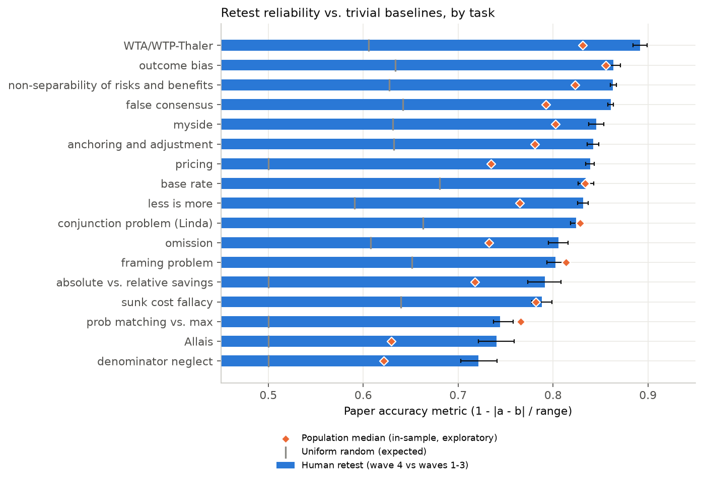
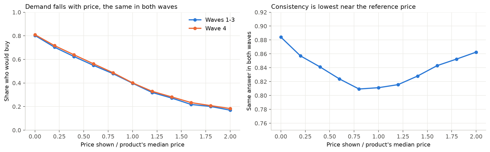
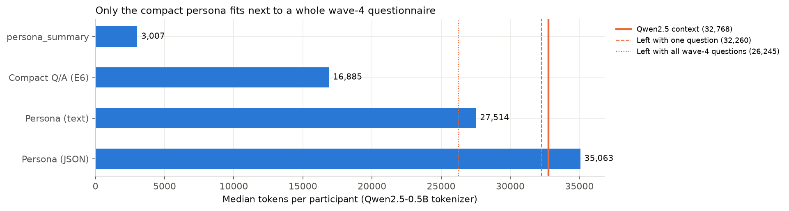

# 01 · Data exploration

**Question:** How predictable are wave-4 answers, and what about the data decides how we can model and evaluate them?

Figures are in `reports/figures/` (drawn by `scripts/eda_figures.py`).

Every number here comes from code in this repo, run on Twin-2K-500 at revision `f883165a` (pinned in `src/data.py`). The commands to reproduce it are at the end. Numbers marked **in-sample** are fitted and scored on all 2,058 people. They describe the data. They are **not** baseline results: E0 is fitted on the training split only (RQ1).

## Key findings

| # | Finding | Evidence |
|---|---|---|
| 1 | Our scorer reproduces the paper exactly: human retest **81.73%** (95% CI 81.42–82.04) vs. the paper's 81.7%, and GPT-4.1-mini text-persona **71.71%** vs. the paper's 71.7%. | `results/metrics/human_retest_overall.json` |
| 2 | **The paper's model accuracy uses each person's wave 1–3 answer as ground truth, not their wave-4 answer.** Retest is symmetric, so it is unaffected. A model scored against wave 4 gets a different number. We report both. | reference `mad_accuracy_evaluation.py`, lines 493–495 |
| 3 | **The leakage trap is a usage trap, not a data error.** `full_persona` is, by design, the wave 1–3 persona **plus the wave-4 answers** to the repeated questions. It does not contain the earlier answers. Where a person's two answers differ (41,242 items), `full_persona` matches wave 4 in 100% of cases. Using it as model input to predict wave 4 puts the answer key in the prompt. `wave_split` already provides the clean decomposition, so Setting A uses `wave_split` only. | `leakage_audit.json → full_persona_trap`, Section 1.1 |
| 4 | Setting A is clean: no wave-4 QuestionID or question text appears in any wave 1–3 persona (0 of 2,058 people). The 634 persona columns and 126 target columns are disjoint. | `leakage_audit.json` |
| 5 | Pricing slots `QID9_1..40` are randomized: every slot shows all 40 products across people. Scoring the population median **by slot** gives 55.9% on pricing. Scoring it **by product × price** gives 73.4%. The slot trap costs **17.5 points** on pricing alone. | `eda_population_baselines_in_sample.csv` |
| 6 | A trivial in-sample population median scores **76.5%** against waves 1–3, above every published LLM simulation (69.4–71.9%). Against wave 4 it scores **77.1%**. This must be re-checked out-of-sample (E0 vs. E4 on the test split) before we claim it. | `eda_population_baselines_in_sample.csv` |
| 7 | Retest is **not a ceiling** on every task. On probability matching, framing and the Linda problem, the population median beats a person's own earlier answer. | `eda_task_headroom.csv`, figure below |
| 8 | With the tokenizer of the POC model (Qwen2.5-0.5B, 32,768-token context), the wave 1–3 persona is **~27.5k tokens** as text and ~35k as JSON. The text fits next to one question, but **0%** of people fit it next to all their wave-4 questions; the JSON never fits. The compact Q/A rendering used for E6 (**~16.9k**) fits for 100%. | `token_counts.json` |
| 9 | The sample skews educated, secular and Democratic, and under-represents Hispanic and 65+ adults. | Section 9 |

## 1. Dataset structure

| Source | What it holds | Use in this project |
|---|---|---|
| HF config `wave_split` | Per person: `wave1_3_persona_text`/`_json` (waves 1–3 *minus* the repeated items), `wave4_Q_wave1_3_A` (wave-4 questions with the earlier answers), `wave4_Q_wave4_A` (wave-4 ground truth) | Setting A input; pricing product/price reconstruction |
| HF config `full_persona` | `persona_text`, `persona_json` (wave 1–3 persona + **wave-4 answers on repeated items**), `persona_summary` | Not needed: `wave_split` holds the same information, already split. Never a model input for wave-4 prediction. |
| `question_catalog_and_human_response_csv/` | 256 QuestionIDs and 760 columns; `wave1_3_response.csv` (persona **and** earlier target answers), `wave4_response.csv` | Tabular baselines, scoring |
| `LLM_simulation_results/` | 13 precomputed GPT-4.1 / GPT-4.1-mini / Gemini simulation specs | E4 (RQ3) |
| `raw_data/` | Anonymized Qualtrics exports and questionnaires | Reference only |

There are 2,058 participants in every source, keyed by `pid` 1–2058. `full_persona` stores `pid` as a string, so `src/data.py` casts it.

### 1.1 How the configs relate (and where the trap is)

Wave 4 asks **no new questions**. It repeats the heuristics-and-biases experiments and the pricing study from waves 1–3. Suppose waves 1–3 asked Q1–Q4 and wave 4 repeated Q4. The person then answered Q4 twice, `A4_old` and `A4_new`:

| Field | Contents | Role |
|---|---|---|
| `wave_split.wave1_3_persona_json` / `_text` | Q1–A1, Q2–A2, Q3–A3 (**Q4 removed**) | Setting A input |
| `wave_split.wave4_Q_wave1_3_A` | Q4–**A4_old** | Setting B input; retest |
| `wave_split.wave4_Q_wave4_A` | Q4–**A4_new** | Ground truth (only the question, without its answer, may go into a prompt) |
| `full_persona.persona_json` / `persona_text` | Q1–A1, Q2–A2, Q3–A3, Q4–**A4_new** | Not used: it equals persona + ground truth |
| `wave1_3_response.csv` | A1, A2, A3 **and A4_old** in one table | Filter through the item registry, or it silently becomes Setting B |

So `full_persona` is consistent and documented ("for questions that appear in both waves 1-3 and wave 4, the wave 4 responses are used"). The trap is in how it gets used. The name suggests "everything we know about this person", the README's first usage example loads it, and nothing fails at run time if it is put into a prompt. A model given `full_persona` and asked about Q4 is shown `A4_new`, and its score rises with no visible error.

**A concrete example, pid 574.** Of this person's 63 wave-4 items, 25 were answered differently in the two waves. On all 25, `full_persona` holds the wave-4 answer:

| Item | Waves 1–3 (`A4_old`) | Wave 4 (`A4_new`) | `full_persona` |
|---|---|---|---|
| Base rate, QID156 (0–100, "probability this person is an engineer") | 50 | **87** | **87** |
| Disease-loss framing, QID158 | slightly favor program A | **slightly favor program B** | **slightly favor program B** |
| Linda conjunction, QID160 (3 rows) | Very / Extremely / Extremely probable | **Moderately** / Extremely / **Moderately** | **Moderately** / Extremely / **Moderately** |
| Outcome bias, QID161 | Correct, all things considered | **Correct, but the opposite would be reasonable too** | **Correct, but the opposite would be reasonable too** |

The same pid has 98 non-blank target columns in `wave1_3_response.csv` (the rest belong to conditions they did not see). For example, `QID287_1..3` are 1, 2, 2 there and 2, 4, 3 in `wave4_response.csv`. That file carries `A4_old`, which is the second, quieter version of the trap.

### Item registry

`src/item_registry.py` builds one row per catalog column with its role, domain, experiment, condition and scorer. **Role is the leakage barrier:** Setting A reads only `role == "persona"`.

| Role | Domain | Columns | Scored |
|---|---|---:|---:|
| persona | demographics | 14 | – |
| persona | personality | 338 | – |
| persona | cognitive (incl. Forward Flow) | 88 | – |
| persona | economic preferences | 194 | – |
| target | heuristics & biases | 86 | 82 |
| target | pricing | 40 | 40 |

The 4 unscored target columns are the anchoring "more or fewer than X?" questions (QID163/165/167/169). The paper scores only the numeric estimate that follows each one.

## 2. Question types and how they are scored

The paper uses one metric for everything: **accuracy = 1 − |prediction − truth| / (max − min)**. It treats every item as an ordered scale. A binary item therefore reduces to exact match, and a 1–7 Likert item gives partial credit. The headline number averages cells within each of **17 tasks**, then averages the tasks for each respondent, then averages respondents.

`src/metrics.py` re-implements this in catalog-column space. It reproduces the published numbers to rounding:

| Published spec | Retest (ours / paper) | LLM (ours / paper) |
|---|---|---|
| Text Persona – GPT-4.1-mini | 0.8173 / 0.817 | 0.7171 / 0.717 |
| JSON Persona – GPT-4.1 | 0.8184 / 0.818 | 0.7122 / 0.712 |
| Text Persona – Gemini-Flash-2.5 | 0.8173 / 0.817 | 0.6939 / 0.694 |

(The retest number moves slightly per spec because the paper drops cells where the LLM gave no answer.)

**Scorer quirks we reproduce, and flag:**

- **Anchoring estimates** (free numbers) are converted to deciles 1–10 using thresholds pooled over each high/low pair. The paper fits these on all participants. Our protocol fits them on training participants only.
- **Sunk cost** answers are free numbers scored on a fixed 0–20 range, so one cell can score below 0.
- Proportion-dominance items are grouped under the "less is more" task.
- All 82 multiple-choice scoring ranges match the item's option count (checked by an automated test).
- Our **eligibility rule**: a cell counts only if both human waves answered it. This puts retest and every model on identical cells (193,464 cells).

## 3. Leakage audit

`python -m scripts.audit_leakage` writes `results/metrics/leakage_audit.json` and a readable [`leakage_audit.md`](../results/metrics/leakage_audit.md) that explains every key: what it checks, how it is computed, and how to read it.

| Check | Result |
|---|---|
| Persona vs. target columns / QuestionIDs overlap | 0 / 0 |
| Wave-4 QuestionID found in a person's wave 1–3 persona JSON | 0 of 2,058 people |
| Exact wave-4 question text found in the persona | 0 |
| Near-duplicate question text (token Jaccard ≥ 0.5, incl. matrix rows) | 0 pairs |
| `full_persona` answer equals wave-4 answer (all compared items) | 100% (129,654 items) |
| …on items where the two waves differ | **100% wave 4** (41,242 items): `full_persona` contains the ground truth, so it is never a model input |
| `wave1_3_response.csv` contains earlier answers to all 126 target columns | Yes. "All columns" silently becomes Setting B. |
| `persona_summary` content | Sections cover wave 1–3 constructs only (Big 5, CRT, risk aversion, …). Keyword hits for "purchase"/"anchor"/"disease" are incidental free text (Forward Flow chains, open answers). Percentiles are computed on the full sample, a mild population-level leak. `persona_summary` exists only in `full_persona`, so if we want a compact persona we rebuild it from `raw_data/wave 1-3 scores.csv` with percentiles fitted on the training split. |

**Not covered by the audit:** *related constructs*. The persona measures things the targets depend on (risk aversion vs. Allais, numeracy vs. denominator neglect). That is signal, not leakage. But it means "zero item overlap" does not mean "independent domains".

## 4. Human test–retest reliability



| | Value |
|---|---|
| Retest, paper metric (participant bootstrap, 2,000 resamples) | **81.73%** [81.42, 82.04] |
| Retest, item-macro (mean of 122 column accuracies) | 82.72% |
| Exact same answer in both waves (all item types, incl. 0–100 sliders) | 62.8% of cells |
| Uniform random answer (expected, analytic) | 59.2% vs. waves 1–3 · 59.4% vs. wave 4 |

By task, retest ranges from **72.2%** (denominator neglect) to **89.2%** (WTA/WTP Thaler). The binary choice tasks (Allais, probability matching, denominator neglect, absolute vs. relative savings) are the least stable.

**Retest is a reference point, not an upper bound.** The orange diamonds show an in-sample population median. It beats the person's own earlier answer on probability matching (76.6 vs. 74.4), framing (81.4 vs. 80.3) and Linda (82.8 vs. 82.4). On these tasks, within-person noise is larger than between-person differences. A model can therefore "beat humans" there by predicting the crowd, which says nothing about knowing the person.

**Room for individual signal** (retest minus in-sample population median) is largest for Allais (+11.1 pp), pricing (+10.4), denominator neglect (+10.0), absolute vs. relative (+7.4) and omission (+7.3). These are the tasks where personalization can show up.

## 5. Trivial baselines (in-sample, exploratory)

| Predictor (fitted on all 2,058) | vs. wave 4 | vs. waves 1–3 | Pricing task |
|---|---:|---:|---:|
| Median per column, pricing **by slot** (wrong) | 76.07% | 75.53% | 55.9% |
| Median per column, pricing **by product × price** | **77.10%** | **76.52%** | 73.4% |
| Published LLM simulations (10 specs with a published summary, paper's target) | – | 69.4–71.9% | – |

The in-sample median beats every published simulation by ~5 points on the paper's own target. That is the headline risk for the LLM approach. It is **not yet a result**: E0 must be fitted on the 1,440 training people, scored on the 311 test people, and compared with E4 rescored on the same people (RQ1 and RQ3).

## 6. Pricing study

- 40 products, each shown to every person exactly once, at one of **11 prices: 0×, 0.2×, …, 2.0× a reference price** (≈7,500 person-products per level).
- Slot → product assignment is randomized per person. Product and price are **identical across waves** for all 82,320 person-products.
- `src/pricing.py` parses `(pid, slot, product, price)` from the question text. Parsed answers match the CSV on a 5,000-row check.



Demand falls smoothly from 80% at price 0 to 17% at 2× the reference price, and is nearly identical in both waves. Agreement between waves is U-shaped, from about 81% near the reference price to 86–88% at the extremes. Choices are least stable where the decision is closest. Since about 20% decline even a free product, "would you buy" partly measures interest in the product, not only price sensitivity.

## 7. Between-subject experiments

15 between-subject experiment blocks (the paper counts 11 experiments) randomize people into 2–3 conditions (e.g. anchoring high/low, disease gain/loss, Thaler WTA/WTP). For every one:

- each person saw exactly one condition,
- the **same condition in both waves** (100%, 2,058/2,058),
- groups are balanced (e.g. 1,009 vs. 1,049; 735/672/651).

Less-is-more and both proportion-dominance experiments share one assignment (A/B/C: 735/672/651), so they are one randomization.

Consequence: E0 must be computed **per condition**. That is automatic here, because each condition has its own columns.

## 8. Persona length and context window



Counted with the tokenizer of the POC model, `Qwen/Qwen2.5-0.5B-Instruct` (context 32,768 tokens), and with GPT-4.1's `o200k_base`:

| Representation | Qwen2.5 tokens (median) | GPT-4.1 o200k (median) |
|---|---:|---:|
| Wave 1–3 persona, text (`wave1_3_persona_text`) | 27,514 | 26,795 |
| Wave 1–3 persona, JSON (`wave1_3_persona_json`) | 35,063 | 34,028 |
| Compact "Q: / A:" persona, as used for E6 (`src/ft_format.render_persona`) | 16,885 | 16,435 |
| `persona_summary` (never an input: its percentiles use all people) | 3,007 | 2,845 |
| One wave-4 question + options | 91 (max 252) | – |
| All of one person's wave-4 questions | 6,267 | – |

Share of people whose persona fits in Qwen's context, with 256 tokens kept for the template and the answer:

| Persona | + the longest single question (32,260 left) | + all their wave-4 questions (≈ 26,245 left) |
|---|---:|---:|
| text | 100% | **0%** |
| JSON | 0% | 0% |
| compact Q/A | 100% | **100%** |

Lengths barely vary between people (text: 27.0k–28.8k), because everyone answered the same survey.

Implication: a model can read the persona as text with one question at a time, but not with a person's whole wave-4 questionnaire in one prompt, which is how E6 is trained (all answers of one person in one example). E6 therefore uses the lossless compact rendering (≈16.9k tokens). The first plan, SmolLM2-360M with an 8,192-token context, could not hold even the compact form, which is why the POC moved to Qwen2.5-0.5B. Shorter still needs **retrieval** of the persona answers relevant to each question ([02 §5](02_model_plan.md)). The GPT-4.1 runs did fit the full persona (≈27k of a 1M-token window), so E4 vs. E6 also differs in **how much persona the model sees**.

## 9. Distributions and representativeness

| Variable | Sample | Approx. US adult benchmark* |
|---|---|---|
| Sex (female) | 50.7% | ~51% |
| Age 18–29 / 30–49 / 50–64 / 65+ | 18.9 / 35.7 / 32.0 / 13.5% | 65+ ≈ 21–22% |
| Education: bachelor's or more | 50.9% | ≈ 35–38% |
| Education: less than high school | 0.8% | ≈ 9–10% |
| Race: White / Black / Hispanic / Asian | 66.1 / 12.2 / 9.4 / 6.8% | Hispanic ≈ 17% |
| Party: Dem / Ind / Rep | 41.2 / 29.6 / 26.2% | – |
| Atheist + agnostic | 25.6% | ≈ 10% |
| US citizen | 99.8% | – |

\*Benchmarks are approximate (ACS / Pew orders of magnitude), quoted for direction only and **not verified in this repo**.

The sample matches the US on sex and region quotas. It over-represents college graduates, the non-religious and Democrats, and under-represents Hispanic adults, people 65+ and people without a high-school diploma. These are typical online-panel skews. Results should be read as "for an online US panel like this", and subgroup analyses need small-cell care: 17 people have less than high school, 16 live in HI/AK.

## 10. Missingness

| Role · domain | Columns | Missing (waves 1–3) | Why |
|---|---:|---:|---|
| persona · demographics | 14 | 0.0% | – |
| persona · cognitive | 88 | 2.7% | Optional text fields |
| persona · economic preferences | 194 | 3.2% | Form fields |
| persona · personality | 338 | 17.4% | **Encoding, not non-response:** the 80 Beck Depression multi-select columns store "not selected" as blank |
| target · heuristics & biases | 86 | 34.9% | **By design:** 56 columns belong to between-subject conditions the person did not see |
| target · pricing | 40 | 0.0% | – |

Feature code must treat multi-select blanks as 0, not NaN. Otherwise imputers will invent depression symptoms.

## 11. Biases and limitations

- **Two time points, ~2 weeks apart.** Retest mixes measurement noise with genuine short-term change. We cannot separate them, and "behavior drift" over months is untestable here.
- **Stated, not revealed, behavior.** Pricing answers are hypothetical purchases with no money at stake.
- **Online-panel skews** (Section 9). Representativeness holds only on the quota variables.
- **Repeated exposure.** Wave 4 participants had seen each item before. Memory and consistency pressure probably *raise* retest relative to independent measurement.
- **Scorer design choices** (Section 2) affect absolute numbers: the 0–20 sunk-cost range, decile binning, and equal task weighting (pricing's 40 items count as one task). We reproduce them for comparability and report item-level results alongside.
- **`persona_summary` and the precomputed simulations** were produced outside this repo. We can check what they contain, but not the prompts behind them.
- Published simulation specs cover different participant sets (1,000–2,058 people). E4 must be rescored on the intersection with our test split.

## 12. What this changes in the plan

1. **Primary target.** Score against wave 4 (assignment framing) *and* waves 1–3 (paper framing). The headline comparison with published LLMs uses waves 1–3.
2. **Decile thresholds** for anchoring: fit on training participants only (`configs/experiment.yaml`).
3. **E0 is strong and condition-aware.** Pricing must use product × price cells.
4. **Persona compression is required** for the POC. Compare trait features vs. top-k retrieval vs. `persona_summary`, with the summary's full-sample percentiles flagged.
5. **Personal information can only show on the high-headroom tasks** (Allais, pricing, denominator neglect, absolute vs. relative, omission). On low-headroom tasks, beating retest says nothing about knowing the person.

## Reproduce

```bash
uv venv --python 3.11 .venv && uv pip install --python .venv/bin/python -r requirements.txt
.venv/bin/python -m scripts.download_data     # pinned revision, ~680 MB
.venv/bin/python -m scripts.audit_leakage     # leakage_audit.json
.venv/bin/python -m scripts.reproduce_retest  # human_retest_*; stops if the paper is not reproduced
.venv/bin/python -m scripts.token_counts      # token_counts.json (downloads the Qwen2.5-0.5B tokenizer)
.venv/bin/python -m scripts.eda               # eda_*.csv and figures
```
