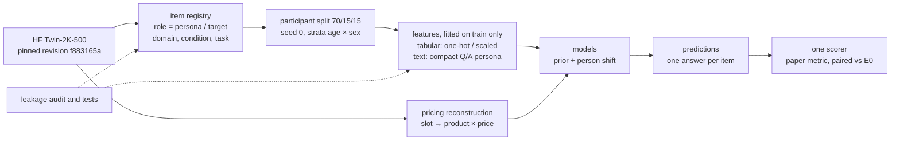
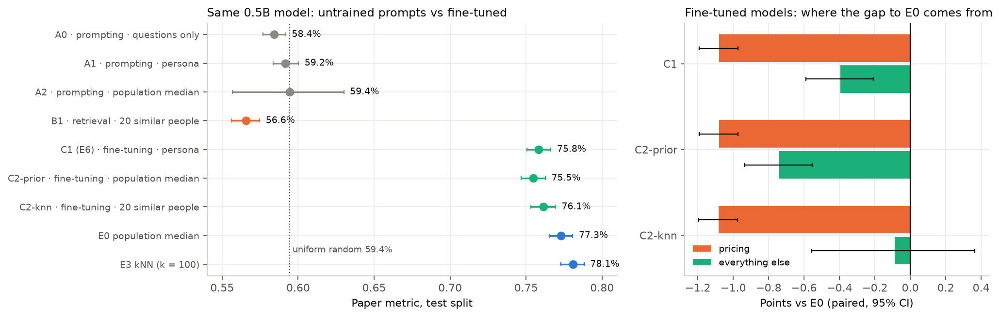

# 02 · Plan to build the behavior model

**Deliverable 2.** How I would build a model that predicts how a person answers the wave-4 questions of Twin-2K-500 from their wave 1–3 answers, written so that another engineer can start from it. The plan comes out of the experiments already run in this repo. Each design choice states the result it rests on and the trade-off it accepts.

Every number about this repo comes from files in `results/` (test split, 311 people, wave-4 answers as truth, paper metric, 95% participant-bootstrap CIs) unless marked otherwise. Numbers about other papers come from their abstracts.

**Naming.** The docs use E2-P / E2-C / E2-E (demographics plus one persona block: Personality, Cognitive tests, Economic preferences) and E2-All (all blocks). In code and result files they are `E2c_personality_raw`, `E2c_cognitive_raw`, `E2c_economic_raw` and `E2b_persona_raw`.

---

## 0. Summary

**Problem.** A digital twin is usually judged by its average accuracy relative to human test–retest. On this dataset that number mostly rewards predicting each item's population answer. The median answer of training participants (E0) scores 77.3%. Human retest scores 81.8%. Every person-level model we built lands between 77.4% and 78.1%.

**What the experiments show.** Personal information helps, but only a little. The best model closes **17%** of the gap between E0 and retest (E3, CI 11–24%). The published LLM twins are below E0. A fine-tuned 0.5B model beats them but is still below E0. On that 0.5B model, prompting and retrieval without training stay at chance; fine-tuning is what makes it use the context it is given.

**Root causes** (Section 2):
1. The metric rewards the population center.
2. The wave 1–3 persona carries little of the person-by-item signal that wave 4 measures.

**Plan.** Build the model as **a population prior plus a learned person-specific shift**. The prior is E0; the shift is learned from the persona and may only move a prediction away from E0 when the data supports it.
- A tabular version of this exists and is the current best.
- The LLM version (E6) works end to end. It has two diagnosed failures with concrete fixes (Section 6.2).
- Putting retrieved similar people into the fine-tuned model's prompt (C2-knn) removes the gap to E0 outside pricing. Pricing fails the same way whatever the prompt contains, so the next step is to change how the model answers, not what it is told (Section 6.3).
- Preference tuning (GRPO) comes last, behind a go/no-go gate. It was not run, because no fine-tuned model has passed that gate yet.

| Approach | Tried here? | Result | Verdict |
|---|---|---|---|
| Population prior (E0) | ✅ | 77.3% | Keep as the prior **and** the baseline every model must beat |
| Tabular regression on persona answers (E1, E2-P/C/E, E2-All) | ✅ | 77.4–78.0%, closes 3–15% of the gap | Current production candidate |
| Retrieval of similar people (E3, kNN) | ✅ | 78.1%, closes 17% (not separable from E2-All) | Useful as a feature or ensemble member, not alone |
| Zero-shot prompting of large LLMs (the paper's GPT-4.1 / GPT-4.1-mini / Gemini runs) | Re-scored | 68.3–72.8%, all below E0 | Not for individual prediction |
| Prompting a < 0.5B LLM without training: questions only, persona, population median in the prompt (A0–A2) | ✅ | 58.4–59.4%, chance level | Not at this size |
| Retrieval of similar people into the prompt, without training (B1) | ✅ | 56.6% | Not at this size |
| Supervised fine-tuning of a < 0.5B LLM (E6) | ✅ | 75.8%, +3.0 over the best published LLM, −1.5 below E0 | Keep; fix decoding and the pricing input next |
| Fine-tuning with retrieved context in the prompt (C2-knn; C2-prior) | ✅ | 76.1%; 75.5%. C2-knn outside pricing: not separable from E0 | Keep C2-knn's input for E6b |
| Preference / RL tuning (DPO, GRPO) | ✗ not run | – | Only after SFT beats E0 on validation (Section 6.4) |

---

## 1. Problem framing

### 1.1 The prediction task

| | Definition |
|---|---|
| Unit | one person × one wave-4 item (the 122 scored columns of `wave4_response.csv`, 17 tasks) |
| Input (Setting A) | the person's wave 1–3 persona: 634 columns / `wave_split.wave1_3_persona_*`, **with the repeated items removed** |
| Never input | the person's earlier answers to the same wave-4 items (that is Setting B, the retest reference), and `full_persona` (it contains the wave-4 answers) |
| Output | one answer per item: the median of the predicted option probabilities (choice and scale items), a number (numeric items), buy / not buy (pricing) |
| Target quantity | person *i*'s wave-4 answer *y* to item *q*, given their persona *x* and the condition *c* they saw (experimental condition; for pricing, the product and price) |
| Generalization claim | **new people on items seen in training**. The 2,058 people are split 70/15/15 (1,440 / 307 / 311), participant-disjoint, stratified by age × sex, seed 0 (`configs/experiment.yaml`). New *questions* are a separate evaluation axis, **not tested here** (Section 8, phase 5; the protocol and its leakage guards are in [03 §4.2](03_evaluation.md)). |

Why the median: the paper metric is an absolute error, and the median of the predicted distribution minimizes the expected absolute error.

### 1.2 What "good" means

Evaluation is the subject of Deliverable 3. The plan uses two of its rules as design targets:
1. Beat **E0** (CI of the paired difference excludes 0). E0 is the trivial baseline that scores 94.4% of retest.
2. Report the **share of the E0 → retest gap closed**, not the share of retest. The share of retest credits what E0 already earns.

---

## 2. Evidence the plan is built on

### 2.1 Results so far (test, wave-4 truth)

| Model | Input | Score | − E0 [95% CI] | Gap E0 → retest closed |
|---|---|---:|---|---:|
| Human retest | the same person's earlier answer | 81.8% | +4.55 [+3.69, +5.39] | 100% |
| E3 kNN (k = 100) | 806 persona features | 78.1% | +0.78 [+0.49, +1.06] | **17.1%** [10.8, 24.0] |
| E2-All | demographics + all blocks (806 features) | 78.0% | +0.67 [+0.28, +1.09] | 14.8% [6.4, 23.5] |
| E2-P | demographics + Personality (413) | 77.8% | +0.50 [+0.18, +0.82] | 11.0% [4.3, 18.2] |
| E1 | demographics (60) | 77.7% | +0.44 [+0.12, +0.77] | 9.7% [2.9, 16.6] |
| E2-C / E2-E | demographics + Cognitive / Economic | 77.5% / 77.4% | CI includes 0 | 4.0% / 3.1% |
| **E0** | median of training people, per item and condition (pricing: per product × price) | **77.3%** | – | 0% |
| C2-knn | E6 + answers of the 20 most similar training people under each item | 76.1% | −1.17 [−1.66, −0.70] | −25.7% |
| E6 | Qwen2.5-0.5B-Instruct + LoRA, SFT on training people | 75.8% | −1.48 [−1.70, −1.26] | −32.5% |
| C2-prior | E6 + training people's typical answer under each item | 75.5% | −1.82 [−2.05, −1.60] | −40.1% |
| Best published LLM (GPT-4.1, JSON persona) | full persona, zero-shot | 72.8% | −4.48 | −98.5% |
| Main published LLM (GPT-4.1-mini, text persona) | full persona, zero-shot | 72.4% | −4.86 [−5.61, −4.18] | −107.0% |
| E5 (A1) | E6 without training | 59.2% | −18.13 | – |
| A0 / A2 / B1 | E5 with questions only / typical answer / 20 similar people in the prompt | 58.4% / 59.4% / 56.6% | −18.86 / −17.87 / −20.74 | – |
| Uniform random | – | 59.4% | | |

E0, E1–E3 and E6 learned from other people's answers to the same items. The published LLMs did not. That E0 beats them is a comparison across regimes, not a controlled experiment. The controlled comparisons are E6 vs E5 (training effect, +16.65 [+15.70, +17.58]), E6 vs E0 (same supervision), and the prompt comparisons on the same 0.5B model in Section 6.3.

### 2.2 Root causes and the evidence for each

| # | Root cause | Evidence | Tested how |
|---|---|---|---|
| 1 | **The metric rewards the population center.** | E0 reaches 94.4% of retest without knowing anyone. Under E6, 7 of 17 tasks score exactly E0's value and 10 are within ±0.25 points. | Observation |
| 2 | **The persona carries little person-by-item signal for wave 4.** | Adding persona blocks to demographics is not separable from demographics alone (every E2 − E1 CI includes 0). The nearest neighbours in 806 dimensions have cosine similarity 0.29 (top-1). | Partially: linear, kNN and 0.5B fine-tuned models all fail to extract more. Larger models are untested. **Persona shuffle** shows the tabular models' predictions depend on the right person's persona: with another person's, they lose 0.9–1.7 points and fall below E0. So the signal is used but its benefit is small, not ignored. |
| 3 | **(E6 only) Exposure bias.** | E6 says "buy" for 0.0% of pricing rows (real 45.7%). Its mean P(buy) is 0.42 in slot 1 and 0.10 averaged over slots 2–40, as the model conditions on its own previous answers (`results/metrics/llm_ablation.md`). | Consistent, not isolated. The isolating test (feed the true previous answers, as in training) is planned. **Lack of information is ruled out:** C2-prior and C2-knn, with the buy rate of training people or the neighbours' decisions written under every pricing item, lose exactly the same −1.08 on pricing, and their P(buy) does not follow the written rate (correlation −0.001). |

The same pattern is reported elsewhere: LLM success that mostly reflects each item's mean answer (Ahn et al., 2026). So causes 1–2 are a replication on this dataset with supervised baselines, not a new discovery.

---

## 3. Design principles

> We prioritize reliable baselines and evidence-driven personalization before introducing greater model complexity.

1. **Prior + shift.** Every model starts from E0 and learns only how a person differs from it. Under maximum regularization it must return E0 exactly. This holds for the logistic and median models through the unpenalized intercept, and for pricing through a fixed logit offset. Tests enforce it. When pricing broke this rule, its score fell 8.7 points below E0 unnoticed (bug found and fixed).
2. **Every input traceable.** Each feature is built by a documented rule in `src/features.py` from a column the item registry marks as input, and keeps that column in its name (e.g. `QID11=2`). This is why the 54 precomputed trait scores were dropped: the dataset does not document their formulas, and only 5 of 54 could be re-derived.
3. **One scorer, one split, one bootstrap.** Every method, ours or published, is re-scored by the same code on the same 311 test people (`src/eval.py`).

---

## 4. Data pipeline



| Step | What it does | Where | Guard |
|---|---|---|---|
| Load | Pinned dataset revision `f883165a`; `full_persona` is loaded only by the leakage audit | `src/data.py`, `scripts/download_data.py` | `scripts/audit_leakage.py` |
| Item registry | Classifies the 760 response columns into 634 persona and 126 target columns, with domain, experimental condition and task. Persona and target sets are disjoint. | `src/item_registry.py` | test: no target column reaches a feature |
| Split | Frozen participant-disjoint split, saved to `data/splits.json` | `src/split.py` | test: disjoint, stable |
| Scoring space | Anchoring free-number answers are converted to deciles with **training-only** thresholds. Pricing is scored per (product, price), not per slot. | `src/metrics.py`, `src/pricing.py` | tests: thresholds use train only; slot trap (slot-level scoring costs 17.5 points on pricing) |
| Tabular features | 14 demographic columns → 60 one-hot features. Raw persona answers: 590 of 634 columns → 806 features. Multi-select blanks are coded as "not selected", not missing. Free text (43 columns) is dropped. Options chosen by fewer than 5 training people are merged into the reference. | `src/features.py` | test: scaling fitted on train; persona-only sources |
| Text persona (LLM) | `wave1_3_persona_json` rendered as compact "Q: / A:" lines without option lists (≈ 17k Qwen tokens instead of 34.7–35.6k). Wave-4 questions the person saw, with answers stripped. Pricing collapsed to one line per product. | `src/ft_format.py`, `scripts/ft_build_data.py` | test: no wave-4 answer in the prompt |
| Targets | Wave-4 answers of **training people only**. The paper's wave 1–3 truth is reported as a second target for comparability. | `src/eval.py` | test: models ignore test answers |

---

## 5. Long personas and the context window

| Representation | Tokens per person (median) | Fits in |
|---|---:|---|
| Persona text | 27,514 (Qwen) / 26,795 (o200k) | Qwen2.5 (32,768) with one question; not with all wave-4 questions (0% of people) |
| Persona JSON | 35,063 (Qwen) / 34,028 (o200k) | none of the small models |
| **Compact Q/A (used for E6)** | 16,885 (Qwen) | Qwen2.5 (32,768), even with all wave-4 questions (100% of people) |
| Full E6 training example (persona + wave-4 questions + answers) | 23,329–24,892 (Qwen) | Qwen2.5, one example per step |
| `persona_summary` (provided by the dataset) | 3,007 (Qwen) | 8k models, **but** its percentiles are computed over all participants, test people included, so it is excluded |

**Options, with trade-offs:**

| Option | Gain | Cost / risk | Status |
|---|---|---|---|
| **Lossless compaction** (drop option lists, Q/A lines) | keeps every answer | still ≈ 17k tokens; one person per step; inference ≈ 45 min per experiment on one H100 | used in E6 |
| **Per-item retrieval**: for each target item, include only the k persona answers most predictive of it, selected on training people (e.g. mutual information) | 10–20× shorter context; batches; smaller GPUs; forces the model to look at relevant evidence | selection can overfit on 1,440 people; must be fitted on train only | **proposed next** |
| Structured extraction (LLM-written persona schema) | +1.91 points over raw transcripts on Twin-2K-500 (Ye et al., 2026) | an extra LLM pass per person; another source of error | later |
| Numeric features instead of text (as E1–E3) | no context limit | loses free text; the median model overfits at 400–800 features (below) | the tabular track |

Evidence for retrieval over "use everything": with all 806 features, validation chose a regularization strength at which the median-regression models of E2-P and E2-All predict a single value for 13–14 of 14 numeric columns. More persona columns overfit before they help. A study on another panel reports that a person's earlier behaviour predicts better than descriptions of them (Pourtaheri & Zareei, 2026).

---

## 6. Modeling

### 6.1 Track A: tabular (current best, production candidate)

One model per scored column, fitted on training people who answered that column (so per experimental condition):

| Answer type | Columns | Model | Decoding |
|---|---:|---|---|
| Discrete, ≤ 11 levels (incl. anchoring deciles) | 68 | multinomial logistic regression, L2 strength C | median of the predicted distribution (argmax drops E1 to 76.72%, below E0) |
| Continuous (0–100 sliders, base rate, sunk cost) | 14 | linear median (quantile) regression, L1 strength α | point prediction |
| Pricing (buy / not buy) | 40 slots, 440 product × price cells | one pooled logistic model: `logit P(buy) = logit(E0 rate of product × price) + w·x + v·x·(price multiplier − 1)` with the E0 term fixed | P(buy) ≥ 0.5 |

**Hyperparameters.** C is searched over 6 values and α over 4, on validation, with the paper metric. Parts that do not depend on the value being changed are reused, which gives identical results in less time. Selected values: E1 C = 0.03, α = 0.01; E2-All C = 0.001, α = 0.1. With more features, validation chooses a stronger brake.

**Next steps for this track (cheap, CPU):**
1. Add α between 0.01 and 0.1. The current grid jumps from "overfits" to "switched off".
2. Per-item feature selection (the retrieval idea from Section 5, applied to features).
3. Stack the published LLM predictions as one extra feature per item. SYN-DIGITS reports that calibrating LLM twins on human data improves individual correlation by up to 50% (Fan et al., 2026). This uses the precomputed simulations as an input, which must be declared in the data map.
4. Gradient boosting (the paper's repository uses XGBoost) as a non-linear check.

### 6.2 Track B: LLM fine-tuning (the "large behavior model" path)

**What was run (E6, the Bonus POC):**

| Item | Value | Reason |
|---|---|---|
| Base model | `Qwen/Qwen2.5-0.5B-Instruct`, 494,032,768 parameters. Training adds 8,798,208 LoRA parameters (502,830,976 in total while training). For inference the adapter is merged into the base weights (`merge_and_unload` in `scripts/ft_predict.py`), so the evaluated model has 494,032,768 parameters (the merge adds none; `results/metrics/e6_run_config.json` records 494,032,768). | < 0.5B (the assignment's limit); 32,768-token context fits the compact persona; the planned SmolLM2-360M has 8,192 and fits no one |
| Method | LoRA on all linear layers, r = 16, α = 32, dropout 0.05; 8,798,208 trainable parameters (1.8%) | memory and speed; standard starting point |
| Objective | causal LM cross-entropy **on answer tokens only** | the persona and questions are context, not targets |
| Example | one person = system prompt + compact persona + that person's wave-4 questions → one line per item, `QID158: 2` | the model sees every answer of the person together |
| Optimizer | AdamW, lr 2e-4, 5% warm-up, cosine decay | 360 optimizer steps only |
| Batch | 1 example × 8 gradient accumulation (≈ 24k tokens per example, max length 26,624) | one 24k-token example per forward pass |
| Epochs | 2, best epoch chosen on validation loss (0.209 → 0.119) | 1,440 examples |
| Memory / speed | bf16, FlashAttention-2, gradient checkpointing; 58.5 min on one H100 80GB | |
| Inference | item IDs are forced; discrete items are scored over all options (median of option probabilities); numeric items are greedy-decoded | avoids free-form formatting errors |

**What failed, and the fix for each:**

| Failure (measured) | Likely cause (consistent with the evidence, not isolated) | Fix in E6b | Expected effect |
|---|---|---|---|
| Pricing: "buy" for 0.0% of rows. Mean P(buy) 0.42 in slot 1, 0.10 over later slots. | **Exposure bias** (likely). Trained with true previous answers (teacher forcing), but at inference it conditions on its own. | Score every item **independently** at inference (no own-answer context). At training, mask or shuffle previous answers. | Should remove the decay (untested). |
| 7 of 17 tasks score exactly E0's value (10 within ±0.25 points); with another person's persona the score drops only 0.39 points (tabular models: 0.9–1.7) | The model learns the population answer (root causes 1 and 2) | **Prior + shift for the LLM**: add E0's log-probabilities as a fixed bias on the answer-option logits, so the LoRA learns only the person-specific shift (the LLM version of design principle 1) | Moves E6 to E0 at worst. Whether it beats E0 is the open question. |

**E6b input, concretely.** Today every answer is generated in one pass, 94–98 lines per person, each conditioned on the model's own previous lines. In E6b each item is scored on its own, with the product and price next to the answer (real item from the training data; format illustrative):

```
[compact Q/A persona of this person: shared prefix, ≈ 17k tokens]
[Pricing] Suppose you are in a grocery store and see each product below at the price shown.
Would you or would you not purchase it?
Options: 1 = Yes, I would purchase the product; 2 = No, I would not purchase the product
QID9_32 [Folgers Classic Roast Ground Coffee, 40.3-Ounce Canister, $23.83]:
→ score options 1 and 2; add E0's log P(option) for this product × price as a fixed bias
```

**Numeric items** (0–100 sliders, base rate, sunk cost) are greedy-decoded today, so they give no distribution. E6b bins them on the scoring scale (deciles for anchoring, as the scorer already does; 10 equal bins for 0–100) and scores every bin like an option. Every item then yields a distribution, at the cost of up to half a bin of resolution (≤ 5 points on a 0–100 item, before averaging).

**Why not one training example per question (yet).** Splitting each person into one example per item removes exposure bias at training time too, but it multiplies the tokens:

```
E6 (one example per person):            1,440 × ~24k tokens          ≈ 35M tokens per epoch
one example per person × item:          1,440 × 94 × ~17k tokens     ≈ 2.3B tokens per epoch   (~67×)
```

E6 trained for 2 epochs in 58.5 minutes on one H100, so the same 2 epochs would take roughly 65 GPU-hours. The order is therefore:
1. **E6b:** keep one training example per person, mask or shuffle the previous answers during training, and score items independently at inference with the persona as a shared prefix (computed once per person and reused for every item).
2. **Then per-item examples**, only after per-item retrieval (Section 5) shortens the persona enough to make them affordable.

Either way, people are split first and expanded into items second, so one person's items never sit in two splits (guard in [03 §4.2](03_evaluation.md)).

**Alternative objectives, as ablations after E6b:**
- **Metric-aligned loss**: expected absolute error under the predicted distribution, `L = Σ_k p_k · |k − y| / (max − min)`. This is the paper metric's expectation. Median decoding is optimal for it.

**Scaling path.** A task-adapted 0.5B model already outperforms the larger zero-shot LLM baselines in this evaluation (+3.0 points), although model size and supervised adaptation were not independently controlled. Its diagnosed failures are in decoding and input layout, not obviously in capacity, so scale only after E6b beats E0 on validation. Then, in order:
1. Qwen2.5-1.5B / 3B with the same recipe (expected to fit one 80GB GPU with LoRA at 24k tokens; not measured).
2. An 8B model with QLoRA if retrieval shortens the context.

### 6.3 Track C: prompting vs retrieval vs fine-tuning

**Same 0.5B model, one thing changed at a time.** The question: is training needed, or is the right context in the prompt enough? Design, validation selection and hypotheses were written before the runs. Every variant uses the scoring of E5/E6 (option likelihoods, median of the distribution). The context sits on its own line under each item and comes from training people only.

| Code | Context under each item | Example line |
|---|---|---|
| A0 | none (questions only) | – |
| A1 = E5 | none; the persona before the questions | – |
| A2 | E0 in the prompt: training people's typical answer; for pricing their buy rate at that price | `(typical answer of other respondents: 4)` · `(10% of other respondents bought it at this price)` |
| B1 | E3's neighbours in the prompt: answers of the 20 most similar training people (cosine on the 806 persona features, same condition) | `(similar respondents answered: 4, 4, 5, 3, 4, …)` · `(similar respondents: bought at $7.94; not at $2.65; …)` |
| C2-prior / C2-knn | A2's / B1's context, fine-tuned with E6's recipe. Training examples use leave-one-out context: a training person is never in their own prior or their own neighbours | as A2 / B1 |

Variants chosen on validation (population median over the distribution of answers; k = 20 over k = 5), then run once on test.



| Comparison (paired, 311 test people) | Δ [95% CI] |
|---|---|
| Untrained: persona vs questions only (A1 − A0) | +0.73 [+0.03, +1.49] |
| Untrained: 20 similar people vs questions only (B1 − A0) | −1.88 [−2.96, −0.81] |
| Training, with the similar-people prompt (C2-knn − B1) | +19.57 [+18.51, +20.71] |
| Fine-tuned: 20 similar people vs population median (C2-knn − C2-prior) | **+0.65 [+0.20, +1.10]** |
| Fine-tuned: 20 similar people vs persona (C2-knn − E6) | +0.31 [−0.16, +0.76] |
| C2-knn outside pricing vs E0 (C2-knn with E0's pricing answers − E0) | **−0.09 [−0.56, +0.37]** |
| C2-knn outside pricing vs E3 | −0.86 [−1.30, −0.42] |

What this shows:
1. **Without training, context does not help a 0.5B model.** It does not copy the hints: given the population median, it repeats it 56% of the time (validation) and gives sunk-cost answers in the hundreds on a 0–20 scale. A2's wide CI comes from those answers: with sunk cost clipped to 0–20 (a diagnostic, not a reported result), A2 scores 67.7% [66.6, 68.8], still far below E0.
2. **Fine-tuning is what makes the model use the context**, and once trained, similar people are more useful than the population median.
3. **Pricing is the same in all three fine-tuned models**: −1.08 [−1.19, −0.97] against E0, "buy" predicted for 0.0–0.5% of rows (real 45.7%), P(buy) falling from 0.42–0.44 in slot 1 to 0.10–0.13 on average in slots 2–40. The fix therefore has to change how the model answers (E6b, Section 6.2), not what it is told. The isolating test of exposure bias is still to be run.
4. C2-knn is the input to keep for E6b. It does not reach E3 outside pricing (−0.86), so retrieval inside the LLM has not yet beaten retrieval alone.

Numbers: `python -m scripts.analyze_llm_ablation` → [results/metrics/llm_ablation.md](../results/metrics/llm_ablation.md).

**Large zero-shot models.** Zero-shot prompting of a large model is kept as a **reference**, not a product candidate:
- every published spec is below E0 (68.3–72.8% vs 77.3%);
- the best, GPT-4.1 with the JSON persona, is still 4.5 points below E0.

Retrieval of similar people (E3) is kept as a feature for Track A.

### 6.4 Preference tuning (DPO / GRPO): last, and gated

| | |
|---|---|
| Reward | the paper metric of a sampled answer against the truth, `1 − |ŷ − y| / range` (verifiable, per item) |
| Why it might help | it optimizes the scored quantity directly and can learn from the order of the answer scale, which cross-entropy ignores |
| Why it might not | its optimum under a per-item reward is again the median answer, which E0 already gives. The metric-aligned loss above gets the same optimum more cheaply. |
| Gate | start only if E6b (SFT + prior + fixes) beats E0 on validation with a CI excluding 0. Otherwise the signal for RL to amplify is absent. |
| Prior work | no published GRPO setup with this kind of reward was found (search 2026-10-19) |
| Status | **not run.** No fine-tuned model has passed the gate: the best, C2-knn, is −1.17 [−1.66, −0.70] below E0 on test. The GPU budget went to the controlled prompting / retrieval / fine-tuning comparison instead (Section 6.3). |

---

## 7. Main risks and mitigations

| Risk | Where it bites | Mitigation (status) |
|---|---|---|
| **Answer leakage through `full_persona`** | it contains the wave-4 answers to repeated items; where a person's two answers differ (41,242 items), it matches wave 4 in 100% | never an input; only `wave_split`; audited and tested ✅ |
| **Leakage through earlier answers in `wave1_3_response.csv`** | the same table holds persona columns and the earlier answers to target items; "use all columns" turns persona-only into Setting B | item-registry roles; test that no target column reaches a feature ✅ |
| **Pricing slot trap** | slots are randomized across products; slot-level modelling costs 17.5 points on pricing | model per product × price ✅ |
| **Test-set reuse** | many experiments on 311 people | hyperparameters chosen on validation only; test scored once by `scripts/evaluate.py`; the next model generation should freeze a new holdout or use cross-validation |
| **Optimizing the metric by predicting the center** | high accuracy that E0 already earns | report the paired difference from E0 and the gap closed, not the share of retest (Deliverable 3) |
| **Overfitting** | 1,440 training people vs 806 features; validation switches off the median models | regularization on validation; per-item feature selection; keep E1 as a simpler fallback |
| **Silent pipeline bugs** | the pricing bug (−8.7 points) was invisible in the total score | invariant tests ("max regularization = E0"); per-task tables; any result that beats or loses to E0 by a lot is explained before it is accepted |
| **Exposure bias in autoregressive answering** | E6 pricing collapse | independent item scoring (E6b) |
| **Pre-training contamination** | the dataset and paper are public (2025); large LLMs may have seen effects or answers | use the held-out split only; compare against E0, which cannot be contaminated; treat zero-shot LLM results as a reference |
| **Representativeness** | online panel: more graduates, more Democrats, fewer Hispanic and 65+ adults | report accuracy per subgroup before use; many groups have < 20 test people |
| **Compute** | 24k-token examples; E6 needs an 80GB GPU for training | retrieval to shorten context; a smoke-test mode for small GPUs |
| **Regime confusion in comparisons** | supervised vs zero-shot | label every leaderboard row with its regime ✅ |

---

## 8. Milestones and decision gates

| Phase | Work | Cost | Go / no-go (validation, paired vs E0) |
|---|---|---|---|
| 0 ✅ | E0, tabular E1–E3, LLM reference, E5/E6 POC, prompting vs retrieval vs fine-tuning (A0–C2), evaluation suite | done | – |
| 1 | Track A extensions: α grid, per-item feature selection, LLM-prediction stacking, gradient boosting | ~1–2 days CPU | adopt if validation gap closed exceeds E2-All's; test scored once at the end |
| 2 | E6b: independent item scoring, inline price, E0 prior as logit bias, binned numeric items; C2-knn's similar-people context as input | ~1 GPU-day | **gate for everything after**: E6b − E0 > 0, CI excludes 0 |
| 3 | Retrieval-based persona; metric-aligned loss ablation; 1.5B–3B models | ~3–5 GPU-days | gap closed above the best tabular model |
| 4 | Preference tuning (GRPO) with the paper-metric reward | ~3–5 GPU-days | improves gap closed over phase 3 |
| 5 | Unseen-question generalization: train on masked wave 1–3 items, test on wave 4 | open | needs its own baseline (no item-level E0 exists for unseen items) |

A shortcut that would change the plan: if phase 1 stacking shows that LLM predictions add nothing beyond tabular features, phases 2–4 are research, not product work.

---

## 9. What I would not do

- **Use `full_persona` or `persona_summary` as inputs.** The first leaks the answers. The second's percentiles include test people.
- **Report "% of retest" alone.** E0 reaches 94.4% of retest without knowing anyone.
- **Ship the zero-shot LLM twin for individual decisions.** It is below the population median here.
- **Scale model size before fixing decoding and the prior.** The current failure is not capacity.
- **Expect prompting to replace training at this size.** Every untrained prompt, including retrieved similar people, scored at chance.

---

## 10. Limits of this plan

- Root cause 2 (little person signal in the persona) is supported only for linear, kNN and 0.5B fine-tuned models. A larger fine-tuned model could extract more. That is what phases 2–3 test.
- Only one hyperparameter set was tried for E6 and C2, and the exposure-bias diagnosis is consistent with the evidence but not isolated.
- The prompting comparison covers one 0.5B model. A larger instruction-tuned model may use in-context information without training.
- All results come from one split of 311 test people. Several comparisons are run at once, and differences under ~0.5 points are within noise. One result already flipped when the representation changed: E2-C's wave 1–3 gain lost significance when PCA was removed.
- Retest is two waves about two weeks apart. Long-run behaviour drift cannot be measured with this dataset (Deliverable 5).
- Claims about other papers are from abstracts, not full texts.

## Sources in this repo

| Claim | File |
|---|---|
| Scores, CIs, gap closed | `results/metrics/leaderboard.md`, `leaderboard.csv` |
| E6 training configuration | `results/metrics/e6_run_config.json`, `e6_train_manifest.json`, `e6_train_log.csv` (copies of `outputs/qwen25_05b_lora/` and `data/ft/`, which are not in git) |
| E6 pricing diagnosis | `results/metrics/llm_ablation.md` (row C1) |
| Prompting vs retrieval vs fine-tuning (A0–C2) | `results/metrics/llm_ablation.md`, `llm_ablation_*.csv`; validation scores in `leaderboard.md` |
| Token counts | `results/metrics/token_counts.json` |
| Leakage audit | `results/metrics/leakage_audit.md` |
| Tabular models and their invariants | `src/models.py` |
